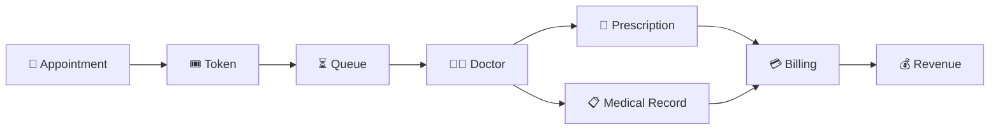
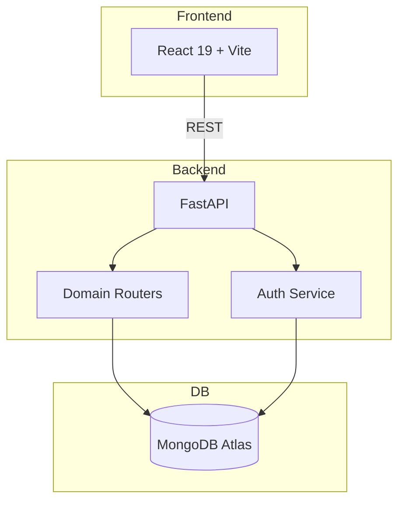

<p align="center">
  <a href="https://noq-hospital.vercel.app/signup">
    
  </a>
  <a href="https://github.com/sunilt808/Noq-hospital">
    
  </a>
  <a href="https://deepwiki.com/sunilt808/Noq-hospital">
    
  </a>
</p>

# 🏥 NOQ

<p align="center">
  <b>Smart Queue Management & Hospital Operations Platform</b><br/>
  <em>Appointments → Tokens → Queues → Consultations → Records → Billing</em>
</p>

---

> **NOQ** is a full-stack hospital management platform that unifies appointments, queues, consultations, medical records, and billing into a single digital journey.

---

## ⚡ Highlights

- 🎟️ **Atomic Token Generation** – Race-condition-free queue management
- 🏥 **Multi-Tenant Architecture** – One platform, many hospitals
- 🔐 **JWT + RBAC Security** – Role-based access across four portals
- 🚫 **No-Show Escalation** – Warn → Fine → Block
- 💰 **Revenue Analytics** – Automated billing & distribution

---

## 🧠 How It Works



---

## 👥 Four Portals

| Portal | Who Uses It | Key Actions |
|:--|:--|:--|
| 👤 **Patient** | Patients & visitors | Book appointments, track queue, view records, pay bills |
| 👨‍⚕️ **Doctor** | Physicians & specialists | Manage queue, consult, prescribe, write records |
| 🏥 **Manager** | Hospital admins | Manage departments, doctors, staff, revenue, analytics |
| 🛡️ **Admin** | Platform operators | Approve hospitals, platform revenue, audit logs |

---

## 🛠️ Tech Stack

<table align="center">
<tr>
<td align="center" width="33%">
  <br/>
  <b>React 19</b><br/>
  <small>Frontend</small>
</td>
<td align="center" width="33%">
  <br/>
  <b>FastAPI</b><br/>
  <small>Backend</small>
</td>
<td align="center" width="33%">
  <br/>
  <b>MongoDB Atlas</b><br/>
  <small>Database</small>
</td>
</tr>
<tr>
<td align="center">
  <br/>
  <b>Vite</b><br/>
  <small>Build Tool</small>
</td>
<td align="center">
  <br/>
  <b>Python 3.11+</b><br/>
  <small>Language</small>
</td>
<td align="center">
  <br/>
  <b>Vercel</b><br/>
  <small>Hosting</small>
</td>
</tr>
</table>

---

## 🚀 Quick Start

### 1️⃣ Clone

```bash
git clone https://github.com/sunilt808/Noq-hospital.git
cd Noq-hospital
```

### 2️⃣ Backend

```bash
cd backend
python -m venv venv
source venv/bin/activate   # or `venv\Scripts\activate` on Windows
pip install -r requirements.txt
```

Create `.env`:

```bash
MONGODB_URL=mongodb://your-mongodb-url
DATABASE_NAME=noq_hospital_db
JWT_SECRET=your-secret
JWT_EXPIRATION_MINUTES=1440
FRONTEND_URL=http://localhost:5173
```

Run:

```bash
python init_mongo.py
uvicorn main:app --host 127.0.0.1 --port 8000 --reload
```

### 3️⃣ Frontend

```bash
cd noq-frontend
npm install
```

Create `.env`:

```bash
VITE_API_URL=http://127.0.0.1:8000
```

Run:

```bash
npm run dev
```

---

## 🏗️ Architecture



---

## 🧩 API Domains

| Domain | Responsibility |
|:--|:--|
| `auth` | Signup, login, JWT issuing |
| `users` | User profiles & management |
| `hospitals` | Hospital management & approval |
| `departments` | Department management |
| `doctors` | Doctor management & assignments |
| `patients` | Patient management |
| `appointments` | Appointment lifecycle |
| `queues` | Queue operations & state management |
| `tokens` | Token generation & tracking |
| `bills` | Billing & payments |
| `revenue` | Revenue analytics & distribution |
| `notifications` | Alert & notification workflows |
| `prescriptions` | Prescription management |
| `medical_records` | Clinical records & history |
| `reviews` | Rating & feedback |
| `complaints` | Complaint handling |

---

## 🔐 Security

**NOQ** implements industry-standard security:

- 🔑 **PBKDF2** password hashing (SHA-256, 100k iterations)
- 🎫 **JWT** authentication (stateless, expiration-based)
- 🛡️ **RBAC** — Role-based access on every endpoint
- 🔒 **Protected frontend routes** — UI guards for each role

---

## 📈 Roadmap

| Priority | Feature | Status |
|:--|:--|:--|
| 🔴 High | Priority Advance Booking (seniors, pregnant, children) | Planned |
| 🟠 Medium | 500m location-based token generation | Planned |
| 🟡 Low | Dockerized deployment | Planned |
| 🟢 Backlog | CI/CD & automated testing | Backlog |

---

## 🤝 Contributing

1. Fork the repo
2. Create a feature branch
3. Commit your changes
4. Push & open a PR

---

<div align="center">

<sub>
  🏥 **NOQ** — *Don't wait in the queue. Know your place in it.*<br/><br/>
  Built with ❤️ by **Sunil T**
</sub>

</div>
