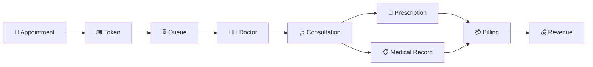
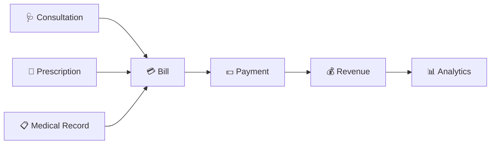
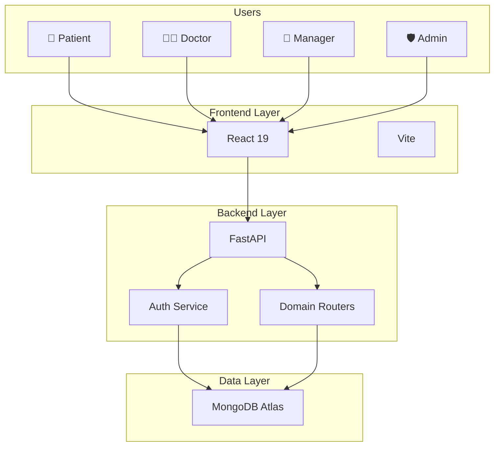

<div align="center">

<h1>🏥 NOQ</h1>

<p>
  <a href="https://noq-hospital.vercel.app/signup">
    
  </a>
  <a href="https://github.com/sunilt808/Noq-hospital">
    
  </a>
  <a href="https://deepwiki.com/sunilt808/Noq-hospital">
    
  </a>
</p>

<h2>Multi-Tenant Hospital Management System</h2>

<p>
  <strong>One platform. Multiple hospitals. Complete healthcare operations.</strong>
</p>

<p>
  NOQ is a full-stack <strong>multi-tenant hospital management system</strong>
  that unifies hospital operations across patients, doctors, hospital managers,
  and platform administrators — from appointments and digital queues to
  consultations, medical records, billing, and revenue.
</p>

</div>


<p>
<strong>
Appointments → Tokens → Queues → Consultations → Medical Records → Billing → Revenue
</strong>
</p>

</div>

---

## 🏥 What is NOQ?

**NOQ is a multi-tenant hospital management and queue operations platform designed to manage the complete lifecycle of hospital operations.**

Instead of treating appointments, queues, consultations, medical records, and billing as separate systems, NOQ connects them into a single workflow.

A hospital can use NOQ to manage:

* 🏥 Hospitals and departments
* 👨‍⚕️ Doctors and staff
* 👤 Patients
* 📅 Appointments
* 🎟️ Digital tokens
* ⏳ Real-time queue workflows
* 🩺 Doctor consultations
* 💊 Prescriptions
* 📋 Medical records
* 💳 Billing and payments
* 💰 Revenue and distribution
* 🔔 Notifications
* ⭐ Reviews and feedback
* 📝 Complaints

NOQ also provides a **platform-level administration layer**, allowing the platform operator to manage hospitals, approvals, users, revenue, and auditing.

---

# 🎯 Why NOQ?

Hospital management is not a single operation.

A patient's journey can involve:

```text
Appointment
     ↓
Token
     ↓
Queue
     ↓
Doctor
     ↓
Consultation
     ↓
Prescription
     ↓
Medical Record
     ↓
Billing
     ↓
Payment
```

Behind this patient journey, hospital administrators also need to manage:

```text
Hospital
   ↓
Departments
   ↓
Doctors
   ↓
Staff
   ↓
Patients
   ↓
Appointments
   ↓
Queues
   ↓
Revenue
   ↓
Analytics
```

When these workflows are disconnected, hospitals have to coordinate between multiple systems and manual processes.

### NOQ connects these operations into one platform.

---

# 🏢 Multi-Tenant Architecture

Multi-tenancy is one of the core concepts behind NOQ.

NOQ is designed so that **multiple hospitals can operate on the same platform**, while each hospital manages its own operational environment.

```text
                              ┌─────────────────────────┐
                              │          NOQ             │
                              │ Multi-Tenant Platform   │
                              └────────────┬────────────┘
                                           │
                 ┌─────────────────────────┼─────────────────────────┐
                 │                         │                         │
                 ▼                         ▼                         ▼
        ┌─────────────────┐       ┌─────────────────┐       ┌─────────────────┐
        │   HOSPITAL A    │       │   HOSPITAL B    │       │   HOSPITAL C    │
        ├─────────────────┤       ├─────────────────┤       ├─────────────────┤
        │ Departments     │       │ Departments     │       │ Departments     │
        │ Doctors         │       │ Doctors         │       │ Doctors         │
        │ Staff           │       │ Staff           │       │ Staff           │
        │ Patients        │       │ Patients        │       │ Patients        │
        │ Appointments    │       │ Appointments    │       │ Appointments    │
        │ Tokens          │       │ Tokens          │       │ Tokens          │
        │ Queues          │       │ Queues          │       │ Queues          │
        │ Medical Records │       │ Medical Records │       │ Medical Records │
        │ Billing         │       │ Billing         │       │ Billing         │
        └─────────────────┘       └─────────────────┘       └─────────────────┘
```

### Why this matters

A single NOQ deployment can support multiple hospitals without requiring each hospital to run a completely separate application.

The architecture provides a foundation for:

* Hospital-level operations
* Hospital-specific users
* Hospital-specific departments
* Hospital-specific doctors
* Hospital-specific patients
* Hospital-specific appointments
* Hospital-specific queues
* Hospital-specific billing
* Hospital-level revenue tracking

---

# 👥 Four Portals

NOQ is built around **four primary portals**, each designed for a different role in the healthcare ecosystem.

## 👤 Patient Portal

Patients can:

* Create an account
* Book appointments
* Select hospitals and departments
* Select doctors
* Receive tokens
* Track queue status
* Follow appointment progress
* View medical records
* View prescriptions
* View bills
* Make payments
* Receive notifications
* Submit reviews
* Submit complaints

---

## 👨‍⚕️ Doctor Portal

Doctors can:

* View assigned appointments
* Manage their queue
* Call patients
* Conduct consultations
* Create prescriptions
* Write medical records
* Review patient history
* Complete consultations
* Manage their clinical workflow

---

## 🏥 Hospital Manager Portal

Hospital managers can manage the operational side of a hospital.

Capabilities include:

* Hospital management
* Department management
* Doctor management
* Staff management
* Patient management
* Appointment monitoring
* Queue monitoring
* Revenue tracking
* Operational analytics
* Reviews
* Complaints
* Hospital-level workflows

---

## 🛡️ Platform Admin Portal

Platform administrators operate the NOQ platform itself.

Capabilities include:

* Hospital approval
* Platform user management
* Hospital oversight
* Platform revenue
* Operational monitoring
* Audit information
* Platform-level administration

---

# 🔄 Complete NOQ Workflow

NOQ connects the complete healthcare journey.



The important idea is that these are not isolated modules.

They form a **connected operational lifecycle**.

---

# 🎟️ Queue & Token Management

The queue system is one of the core parts of NOQ.

A typical flow is:

```text
┌───────────────┐
│  Appointment  │
└───────┬───────┘
        ↓
┌───────────────┐
│ Token Created │
└───────┬───────┘
        ↓
┌───────────────┐
│    WAITING    │
└───────┬───────┘
        ↓
┌───────────────┐
│     CALLED    │
└───────┬───────┘
        ↓
┌──────────────────┐
│ IN CONSULTATION  │
└───────┬──────────┘
        ↓
┌───────────────┐
│   COMPLETED   │
└───────────────┘
```

## ⚛️ Atomic Token Generation

NOQ uses an **atomic token-generation approach** to protect queue integrity when multiple requests happen concurrently.

The objective is to prevent:

* Duplicate token assignment
* Conflicting token numbers
* Race-condition-related queue corruption

This is especially important in a real hospital environment where multiple patients may request appointments or tokens around the same time.

---

# 🚫 No-Show Escalation

NOQ also includes a structured no-show workflow.

```text
             Missed Appointment
                    │
                    ▼
                 Warning
                    │
                    ▼
                  Fine
                    │
                    ▼
                 Block
```

Instead of simply marking an appointment as missed, NOQ provides an escalation model for repeated no-shows.

This allows hospitals to enforce their own operational policies.

---

# 💳 Billing & Revenue

NOQ connects clinical operations with financial operations.



This creates a complete path from:

**Patient → Consultation → Bill → Payment → Revenue → Analytics**

---

# 🔐 Security Architecture

Security is implemented at both the authentication and authorization levels.

```text
                     ┌─────────────────┐
                     │      NOQ        │
                     └────────┬────────┘
                              │
                     ┌────────▼────────┐
                     │ Authentication  │
                     │      JWT        │
                     └────────┬────────┘
                              │
                     ┌────────▼────────┐
                     │      RBAC       │
                     └────────┬────────┘
                              │
          ┌───────────────────┼───────────────────┐
          │                   │                   │
          ▼                   ▼                   ▼
      Patient              Doctor             Manager
                                                  │
                                                  ▼
                                                Admin
```

### Security Features

* 🔑 PBKDF2 password hashing
* 🔐 SHA-256 based password hashing
* 🎫 JWT authentication
* ⏱️ JWT expiration
* 🛡️ Role-Based Access Control
* 🔒 Protected API endpoints
* 🚧 Protected frontend routes
* 👥 Role-specific portal access

---

# 🧱 System Architecture

NOQ follows a frontend → API → domain router → database architecture.



---

# 🏗️ Architecture Layers

## 🎨 Presentation Layer

Built with:

* React 19
* Vite
* Role-specific frontend portals
* Protected routes
* REST API integration

---

## 🚀 API Layer

Built with:

* FastAPI
* Python 3.11+
* Domain-based routers
* JWT authentication
* Role-based authorization

---

## 🧩 Domain Layer

NOQ separates hospital operations into dedicated API domains.

```text
Authentication
      │
      ├── Users
      ├── Hospitals
      ├── Departments
      ├── Doctors
      ├── Patients
      ├── Appointments
      ├── Queues
      ├── Tokens
      ├── Bills
      ├── Revenue
      ├── Notifications
      ├── Prescriptions
      ├── Medical Records
      ├── Reviews
      └── Complaints
```

---

## 🍃 Data Layer

NOQ uses **MongoDB Atlas** as its primary database.

The database layer supports the platform's:

* Multi-hospital data
* User data
* Appointment data
* Queue data
* Token data
* Clinical data
* Billing data
* Revenue data
* Notification data

---

# 🧩 API Domains

| Domain            | Responsibility                        |
| :---------------- | :------------------------------------ |
| `auth`            | Signup, login, JWT issuing            |
| `users`           | User profiles and management          |
| `hospitals`       | Hospital management and approval      |
| `departments`     | Department management                 |
| `doctors`         | Doctor management and assignments     |
| `patients`        | Patient management                    |
| `appointments`    | Appointment lifecycle                 |
| `queues`          | Queue operations and state management |
| `tokens`          | Token generation and tracking         |
| `bills`           | Billing and payments                  |
| `revenue`         | Revenue analytics and distribution    |
| `notifications`   | Alerts and notification workflows     |
| `prescriptions`   | Prescription management               |
| `medical_records` | Clinical records and history          |
| `reviews`         | Ratings and feedback                  |
| `complaints`      | Complaint handling                    |

---

# ⚡ Core Features

### 🏢 Multi-Tenant Hospital Management

Manage multiple hospitals from a single platform architecture.

### 👥 Role-Based Portals

Four dedicated experiences:

**Patient → Doctor → Manager → Admin**

### 📅 Appointment Management

Manage the appointment lifecycle from booking through consultation.

### 🎟️ Atomic Token Generation

Generate queue tokens safely under concurrent requests.

### ⏳ Digital Queue Management

Track and manage patient queues throughout the consultation lifecycle.

### 👨‍⚕️ Doctor Workflow

Doctors can manage queues, consult patients, prescribe medication, and maintain records.

### 📋 Medical Records

Maintain clinical records and patient history.

### 💊 Prescription Management

Create and manage prescriptions as part of the consultation workflow.

### 💳 Billing & Payments

Connect hospital services with billing and payment workflows.

### 💰 Revenue Analytics

Track and distribute revenue across the platform and hospital operations.

### 🚫 No-Show Enforcement

Warning → Fine → Block escalation.

### 🔔 Notifications

Support notification and alert workflows across the platform.

### ⭐ Reviews

Allow patients to provide ratings and feedback.

### 📝 Complaints

Provide a structured complaint-management workflow.

### 🔐 Security

JWT authentication combined with RBAC and protected routes.

---

# 📊 NOQ at a Glance

| Capability                | Status |
| :------------------------ | :----: |
| Multi-Tenant Architecture |    ✅   |
| Multiple Hospitals        |    ✅   |
| Patient Portal            |    ✅   |
| Doctor Portal             |    ✅   |
| Manager Portal            |    ✅   |
| Admin Portal              |    ✅   |
| Appointment Management    |    ✅   |
| Token Generation          |    ✅   |
| Atomic Queue Operations   |    ✅   |
| Queue Management          |    ✅   |
| Doctor Consultations      |    ✅   |
| Prescriptions             |    ✅   |
| Medical Records           |    ✅   |
| Billing                   |    ✅   |
| Payments                  |    ✅   |
| Revenue Analytics         |    ✅   |
| No-Show Escalation        |    ✅   |
| Notifications             |    ✅   |
| Reviews                   |    ✅   |
| Complaints                |    ✅   |
| JWT Authentication        |    ✅   |
| RBAC                      |    ✅   |

---

# 🛠️ Technology Stack

<div align="center">

<table>
<tr>
<td align="center" width="25%">

### ⚛️ Frontend

React 19

Vite

</td>

<td align="center" width="25%">

### 🚀 Backend

FastAPI

Python 3.11+

</td>

<td align="center" width="25%">

### 🍃 Database

MongoDB Atlas

</td>

<td align="center" width="25%">

### ▲ Deployment

Vercel

</td>
</tr>
</table>

</div>

| Layer            | Technology       |
| :--------------- | :--------------- |
| Frontend         | React 19         |
| Build Tool       | Vite             |
| Backend          | Python 3.11+     |
| API Framework    | FastAPI          |
| Database         | MongoDB Atlas    |
| Authentication   | JWT              |
| Password Hashing | PBKDF2 + SHA-256 |
| Authorization    | RBAC             |
| Hosting          | Vercel           |

---

# 🗂️ Project Structure

```text
Noq-hospital/
│
├── backend/
│   │
│   ├── routers/
│   │   ├── auth/
│   │   ├── users/
│   │   ├── hospitals/
│   │   ├── departments/
│   │   ├── doctors/
│   │   ├── patients/
│   │   ├── appointments/
│   │   ├── queues/
│   │   ├── tokens/
│   │   ├── bills/
│   │   ├── revenue/
│   │   ├── notifications/
│   │   ├── prescriptions/
│   │   ├── medical_records/
│   │   ├── reviews/
│   │   └── complaints/
│   │
│   ├── main.py
│   ├── init_mongo.py
│   ├── requirements.txt
│   └── .env
│
├── noq-frontend/
│   │
│   ├── src/
│   ├── public/
│   ├── package.json
│   └── .env
│
└── README.md
```

---

# 🔌 Application Flow

```text
                         NOQ PLATFORM
                              │
          ┌───────────────────┼───────────────────┐
          │                   │                   │
          ▼                   ▼                   ▼
      Patients             Doctors            Managers
          │                   │                   │
          └───────────────────┼───────────────────┘
                              │
                              ▼
                       FastAPI Backend
                              │
             ┌────────────────┼────────────────┐
             │                │                │
             ▼                ▼                ▼
          Auth            Domains           RBAC
             │                │                │
             └────────────────┼────────────────┘
                              │
                              ▼
                        MongoDB Atlas
```

---

# 🚀 Quick Start

## 1. Clone the Repository

```bash
git clone https://github.com/sunilt808/Noq-hospital.git
cd Noq-hospital
```

---

## 2. Backend Setup

```bash
cd backend
```

Create a virtual environment:

```bash
python -m venv venv
```

### Linux / macOS

```bash
source venv/bin/activate
```

### Windows

```bash
venv\Scripts\activate
```

Install dependencies:

```bash
pip install -r requirements.txt
```

---

## 3. Backend Environment Variables

Create:

```text
backend/.env
```

Add:

```env
MONGODB_URL=mongodb://your-mongodb-url
DATABASE_NAME=noq_hospital_db

JWT_SECRET=your-secret
JWT_EXPIRATION_MINUTES=1440

FRONTEND_URL=http://localhost:5173
```

---

## 4. Initialize MongoDB

```bash
python init_mongo.py
```

---

## 5. Start Backend

```bash
uvicorn main:app --host 127.0.0.1 --port 8000 --reload
```

Backend:

```text
http://127.0.0.1:8000
```

---

## 6. Frontend Setup

Open another terminal:

```bash
cd noq-frontend
```

Install dependencies:

```bash
npm install
```

Create:

```text
noq-frontend/.env
```

Add:

```env
VITE_API_URL=http://127.0.0.1:8000
```

Start the frontend:

```bash
npm run dev
```

---

# 🔐 Environment Variables

## Backend

```env
MONGODB_URL=
DATABASE_NAME=
JWT_SECRET=
JWT_EXPIRATION_MINUTES=
FRONTEND_URL=
```

## Frontend

```env
VITE_API_URL=
```

> Never commit `.env` files or production secrets to the repository.

---

# 🧪 Development

Recommended local environment:

```text
Frontend
React 19 + Vite
       │
       │ REST
       ▼
Backend
FastAPI
       │
       ▼
MongoDB Atlas
```

---

# 🗺️ Roadmap

| Priority   | Feature                                                           |   Status   |
| :--------- | :---------------------------------------------------------------- | :--------: |
| 🔴 High    | Priority advance booking for seniors, pregnant patients, children | 🟡 Planned |
| 🟠 Medium  | 500m location-based token generation                              | 🟡 Planned |
| 🟡 Low     | Dockerized deployment                                             | 🟡 Planned |
| 🟢 Backlog | CI/CD                                                             |  ⚪ Backlog |
| 🟢 Backlog | Automated testing                                                 |  ⚪ Backlog |

---

# 🤝 Contributing

Contributions are welcome.

### 1. Fork the repository

### 2. Create a feature branch

```bash
git checkout -b feature/your-feature
```

### 3. Make your changes

### 4. Commit

```bash
git add .
git commit -m "feat: add your feature"
```

### 5. Push

```bash
git push origin feature/your-feature
```

### 6. Open a Pull Request

---

# 📌 Project Highlights

NOQ brings together several traditionally separate hospital workflows into a single system:

```text
                    ┌─────────────────────┐
                    │         NOQ         │
                    │ Hospital Operations │
                    └──────────┬──────────┘
                               │
        ┌──────────────────────┼──────────────────────┐
        │                      │                      │
        ▼                      ▼                      ▼
   Patient Side           Clinical Side         Management Side
        │                      │                      │
   Appointments            Doctors                Hospitals
   Tokens                  Queues                 Departments
   Queue Tracking          Consultation           Staff
   Payments                Prescriptions          Revenue
   Records                 Records                Analytics
        │                      │                      │
        └──────────────────────┼──────────────────────┘
                               │
                               ▼
                         Platform Admin
                               │
                     Hospitals + Auditing
                     + Platform Revenue
```

---

<div align="center">

# 🏥 NOQ

### Multi-Tenant Hospital Management System

**One Platform. Multiple Hospitals. Complete Operations.**

**Don't wait in the queue. Know your place in it.**

<br>

Built with ❤️ by **Sunil T**

<br>

\\
</div>
