<div align="center">

# 🏥 **NOQ**  
### Smart Queue Management & Hospital Operations Platform  

**Appointments → Tokens → Queues → Consultations → Records → Billing**  

<br/>


<br/>

<a href="https://noq-hospital.vercel.app/signup"></a>
<a href="https://github.com/sunilt808/Noq-hospital"></a>
<a href="https://deepwiki.com/sunilt808/Noq-hospital"></a>

<br/><br/>

<div style="width: 80%; height: 2px; background: linear-gradient(90deg, #61DAFB, #009688, #47A248); margin: 0 auto;"></div>

</div>

---

## 📋 Table of Contents

- [Overview](#-overview)
- [The Problem](#-the-problem)
- [Core Features](#-core-features)
- [How NOQ Works](#-how-noq-works)
- [Smart Queue Engine](#-smart-queue-engine)
- [Priority & Location-Aware Booking](#-priority--location-aware-booking)
- [Role-Based System](#-role-based-system)
- [No-Show Management](#-no-show-management)
- [Billing & Revenue](#-billing--revenue)
- [Security](#-security)
- [Architecture](#-architecture)
- [Backend Design](#-backend-design)
- [Deployment](#-deployment)
- [Tech Stack](#-tech-stack)
- [Local Setup](#-local-setup)
- [Engineering Highlights](#-engineering-highlights)
- [Roadmap](#-roadmap)

---

## 📌 Overview

**NOQ** is a full-stack hospital management platform built around one central problem:

> *How can hospitals reduce unnecessary physical queues while keeping appointments, doctors, patients, records and billing connected?*

NOQ transforms the traditional hospital visit into a seamless digital workflow. Instead of treating appointments, queues, consultations, and billing as separate modules, the platform connects them around the **patient journey**.

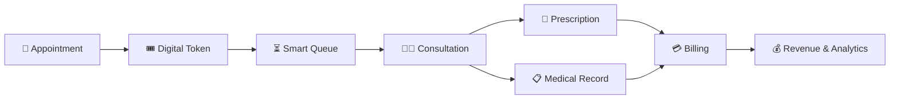

---

## 🎯 The Problem

A typical hospital visit involves:

- ❌ **Long queues** & **uncertain waiting**
- ❌ **Manual coordination** & crowded premises
- ❌ **Disconnected workflows** (appointment → doctor → billing)
- ❌ **No-show appointments** & fragmented billing

NOQ addresses these as an **end-to-end workflow**, not just digitized forms.

```text
   LESS PHYSICAL WAITING
             ↓
   BETTER QUEUE CONTROL
             ↓
   BETTER PATIENT FLOW
             ↓
   BETTER HOSPITAL OPERATIONS
```

---

## ✨ Core Features

<div align="center">
<table>
<tr>
<td align="center" width="50%" style="padding: 15px; background: #f8f9fa; border-radius: 10px; border: 1px solid #dee2e6;">
  
  🎟️ **Smart Queue**  
  <small>Atomic token generation & lifecycle</small>
</td>
<td align="center" width="50%" style="padding: 15px; background: #f8f9fa; border-radius: 10px; border: 1px solid #dee2e6;">
  
  🏥 **Multi-Tenant**  
  <small>Multiple hospitals, one platform</small>
</td>
</tr>
<tr>
<td align="center" style="padding: 15px; background: #f8f9fa; border-radius: 10px; border: 1px solid #dee2e6;">
  
  📅 **Appointments**  
  <small>Booking & lifecycle management</small>
</td>
<td align="center" style="padding: 15px; background: #f8f9fa; border-radius: 10px; border: 1px solid #dee2e6;">
  
  👥 **Four Portals**  
  <small>Patient • Doctor • Manager • Admin</small>
</td>
</tr>
<tr>
<td align="center" style="padding: 15px; background: #f8f9fa; border-radius: 10px; border: 1px solid #dee2e6;">
  
  🔐 **Secure Access**  
  <small>JWT + RBAC + protected routes</small>
</td>
<td align="center" style="padding: 15px; background: #f8f9fa; border-radius: 10px; border: 1px solid #dee2e6;">
  
  🚫 **No-Show Control**  
  <small>Warn → Fine → Block escalation</small>
</td>
</tr>
<tr>
<td align="center" style="padding: 15px; background: #f8f9fa; border-radius: 10px; border: 1px solid #dee2e6;">
  
  🩺 **Clinical Workflow**  
  <small>Consultations, prescriptions, records</small>
</td>
<td align="center" style="padding: 15px; background: #f8f9fa; border-radius: 10px; border: 1px solid #dee2e6;">
  
  💰 **Financial Workflow**  
  <small>Billing, revenue distribution, analytics</small>
</td>
</tr>
<tr>
<td align="center" style="padding: 15px; background: #f8f9fa; border-radius: 10px; border: 1px solid #dee2e6;">
  
  🔔 **Notifications**  
  <small>Appointment & operational alerts</small>
</td>
<td align="center" style="padding: 15px; background: #f8f9fa; border-radius: 10px; border: 1px solid #dee2e6;">
  
  🧾 **Auditability**  
  <small>Traceability for critical actions</small>
</td>
</tr>
</table>
</div>

---

## 🧠 How NOQ Works

The platform connects four major actors:

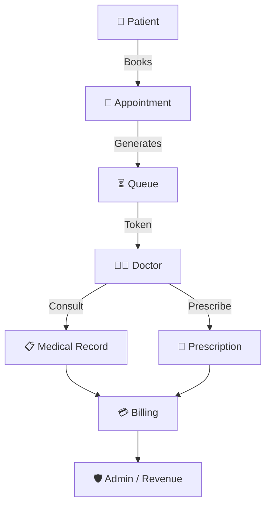

---

## 🎟️ Smart Queue Engine

A patient traverses a **stateful queue**:

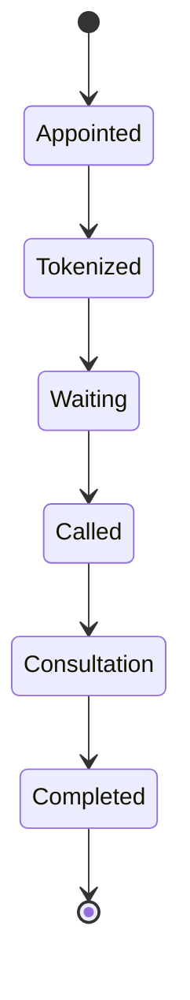

### ⚙️ Atomic Token Generation

To avoid race conditions, NOQ uses **atomic MongoDB updates**:

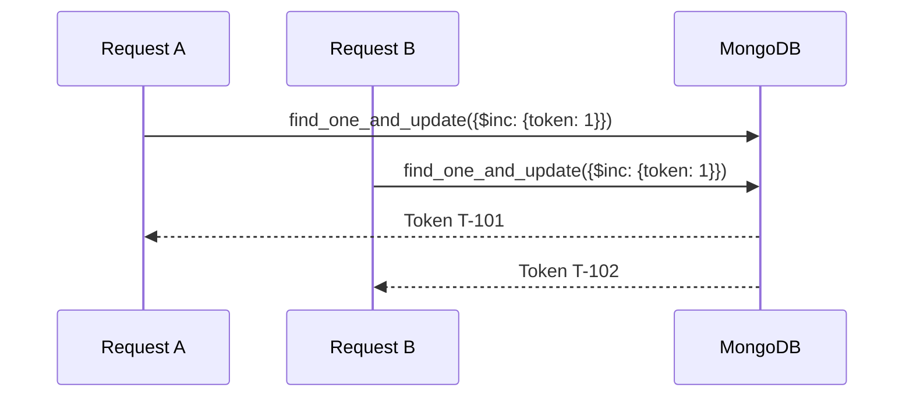

> 💡 **Key insight:** Token allocation is an **atomic database operation**, not a client-side counter.

---

## 📍 Priority & Location-Aware Booking

### 👴 Priority Advance Booking

| Priority Category | Criteria |
| :-- | :-- |
| 👴 **Senior Citizen** | Age ≥ 70 |
| 🤰 **Pregnant Patient** | — |
| 👶 **Child** | Age < 7 |

### 📍 500-Meter Normal Token Rule

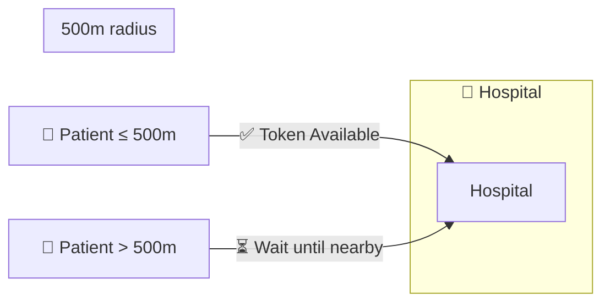

> **Purpose:** Reduce early arrivals, physical crowding, and traffic around hospital premises.

---

## 👥 Role-Based System

| Role | Responsibilities |
| :-- | :-- |
| 👤 **Patient** | Appointments, tokens, queue tracking, records, prescriptions, bills |
| 👨‍⚕️ **Doctor** | Queue management, consultations, prescriptions, records |
| 🏥 **Hospital Manager** | Departments, rooms, doctors, staff, revenue, analytics |
| 🛡️ **System Admin** | Hospital approval, platform management, revenue, audit |

### Workflow Summaries

**Patient:**  
`Register → Discover Hospital → Choose Doctor → Book → Token → Track → Consult → Prescription → Bill`

**Doctor:**  
`Login → View Appointments → Open Queue → Call Next → Consult → Prescribe → Record → Complete`

**Manager:**  
`Hospital → Departments → Doctors → Rooms → Staff → Appointments → Queues → Revenue`

---

## 🚫 No-Show Management

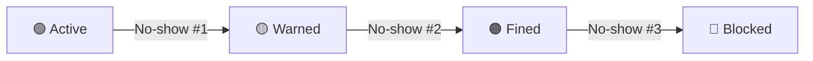

| Level | State | Effect |
| :-- | :-- | :-- |
| 0 | 🟢 Active | Normal booking |
| 1 | 🟡 Warned | Warning issued |
| 2 | 🟠 Fined | ₹200 fine recorded |
| 3 | 🔴 Blocked | New appointments prevented |

---

## 💰 Billing & Revenue

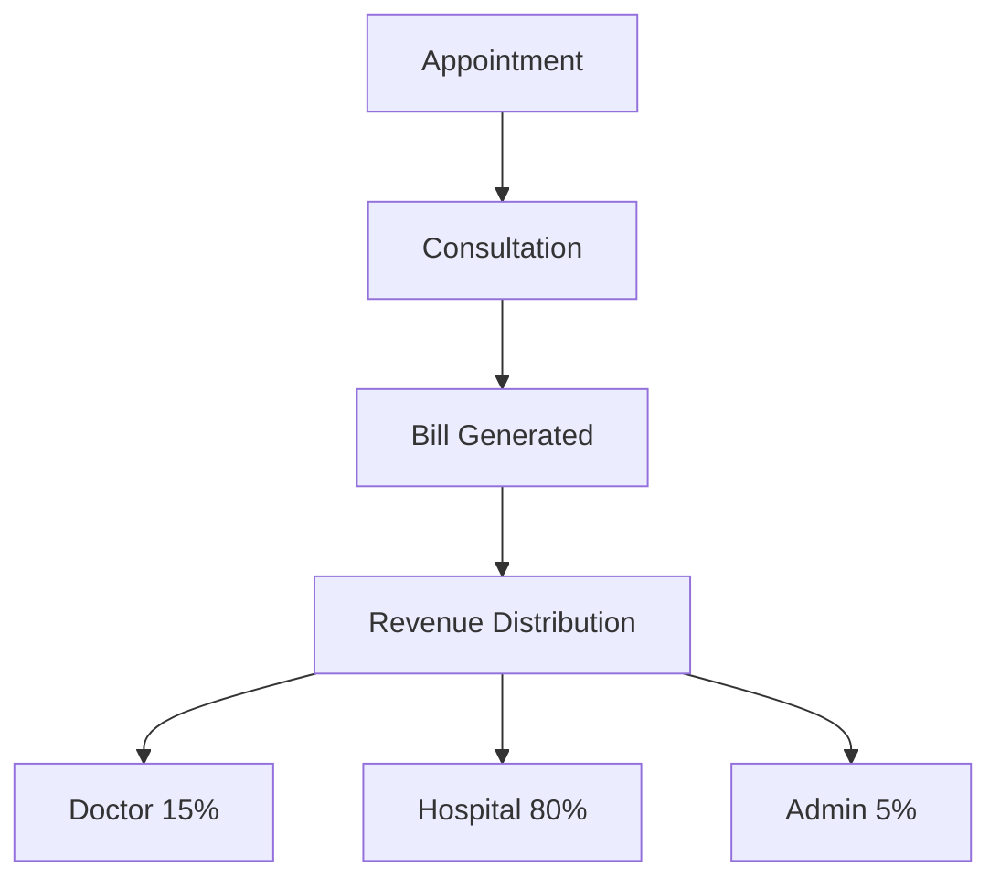

---

## 🔐 Security

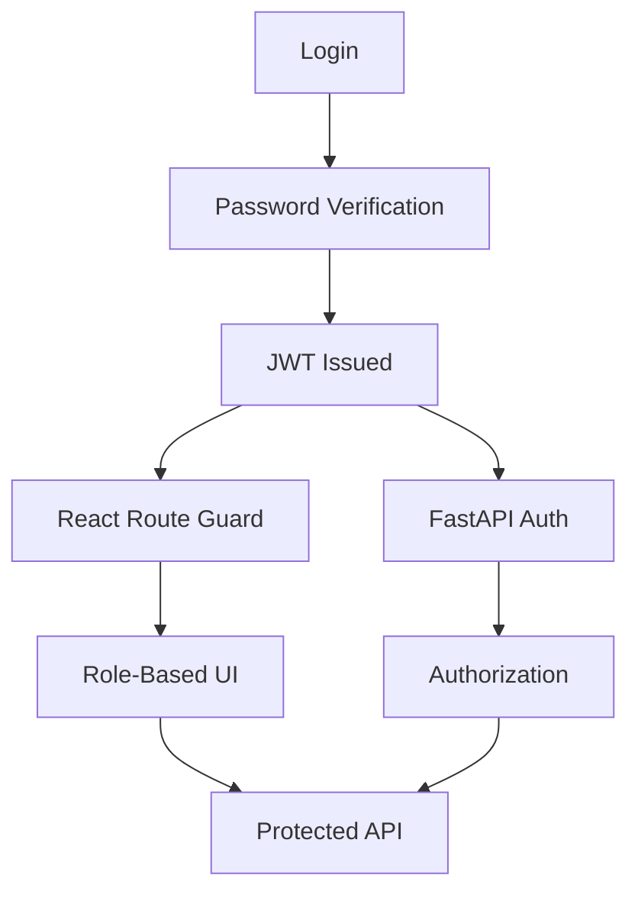

**Password Security:** PBKDF2, SHA-256, random salts, 100,000 iterations.  
**Authorization:** JWT + RBAC + protected routes + backend checks.

---

## 🧾 Auditability

All critical actions are logged:

```text
Authentication → Login, Signup, Password Reset, Credential Changes
Business Activity → Important status / workflow changes
```

---

## 🏢 Multi-Tenant Architecture

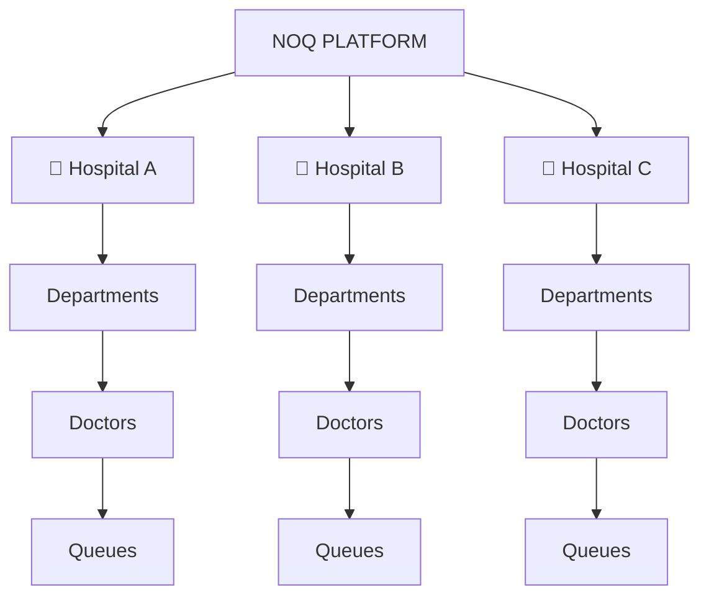

---

## 🏗️ Architecture

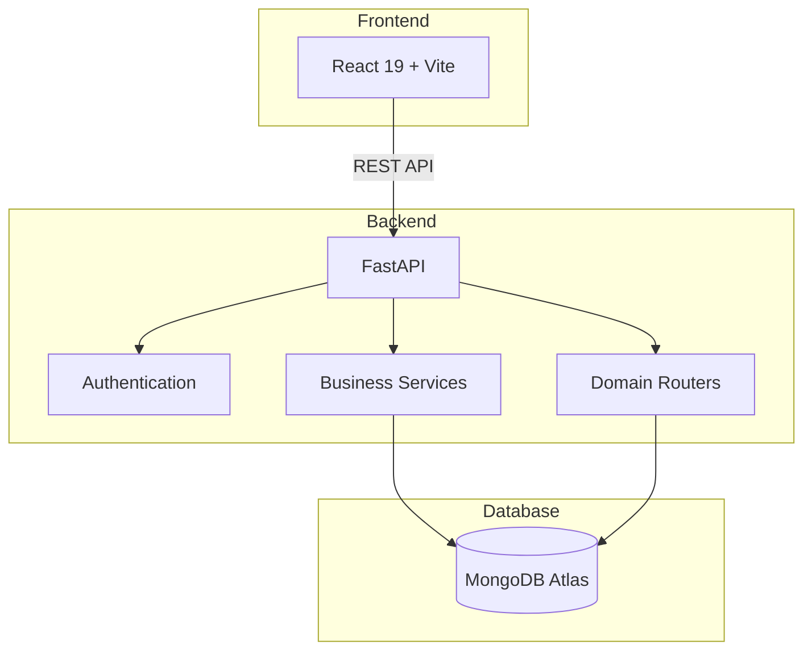

---

## 🧩 Backend Design

```
backend/
│
├── routes/
│   ├── auth
│   ├── users
│   ├── hospitals
│   ├── departments
│   ├── rooms
│   ├── doctors
│   ├── patients
│   ├── appointments
│   ├── queues
│   ├── tokens
│   ├── advanced_bookings
│   ├── bills
│   ├── revenue
│   ├── notifications
│   ├── prescriptions
│   ├── medical_records
│   ├── reviews
│   ├── complaints
│   └── ...
│
├── services/
│
├── database.py
├── main.py
├── init_mongo.py
└── requirements.txt
```

**18+ domain routers** keep business areas separated.

---

## 🔄 Request Lifecycle

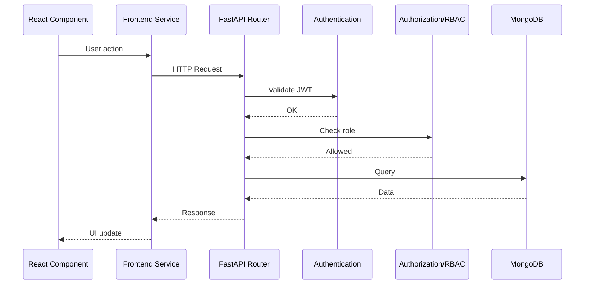

---

## 🗄️ Core Data Model

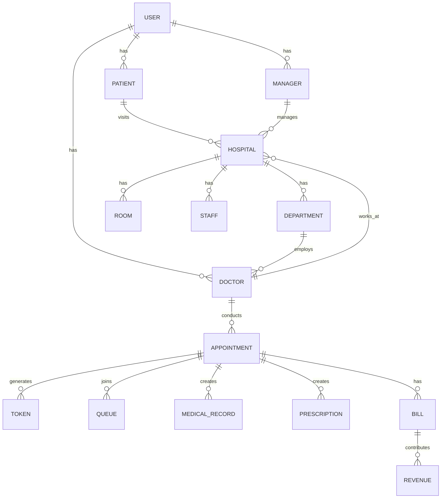

---

## 🌐 API Domains

| Domain | Responsibility |
| :-- | :-- |
| Authentication | Signup, login and authentication |
| Users | User profiles |
| Hospitals | Hospital management |
| Departments | Department management |
| Rooms | Room management |
| Doctors | Doctor management |
| Patients | Patient management |
| Appointments | Appointment lifecycle |
| Queues | Queue operations |
| Tokens | Token operations |
| Advanced Bookings | Priority booking workflows |
| Bills | Billing |
| Revenue | Revenue and analytics |
| Notifications | Notifications |
| Prescriptions | Prescription management |
| Medical Records | Clinical records |
| Reviews | Reviews and ratings |
| Complaints | Complaint workflows |

---

## 🚀 Deployment

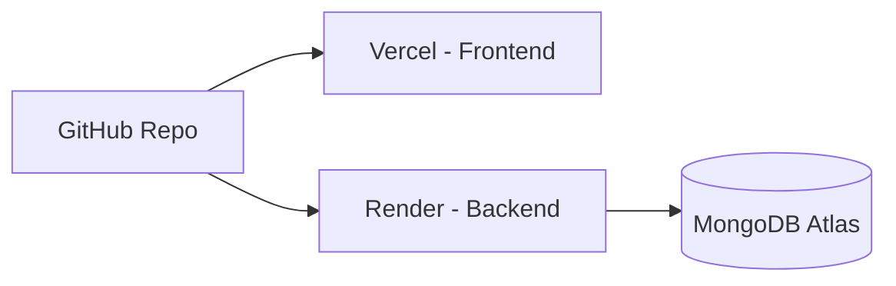

### Production Stack

| Component | Platform |
| :-- | :-- |
| Frontend | Vercel |
| Backend | Render |
| Database | MongoDB Atlas |

---

## 🛠️ Tech Stack

**Languages:** Python 3.11+ • JavaScript • HTML • CSS  
**Frontend:** React 19 • Vite  
**Backend:** FastAPI • Python  
**Database:** MongoDB Atlas  
**DevOps:** Vercel • Docker • Kubernetes • Jenkins • Terraform  
**Security:** JWT • RBAC • PBKDF2

---

## ⚙️ Local Setup

### Prerequisites

- Python 3.11+
- Node.js
- npm
- MongoDB Atlas account

### Clone

```bash
git clone https://github.com/sunilt808/Noq-hospital.git
cd Noq-hospital
```

### Backend

```bash
cd backend
python -m venv venv
```

**Windows:** `venv\Scripts\activate`  
**Linux/macOS:** `source venv/bin/activate`

```bash
pip install -r requirements.txt
```

Create `backend/.env`:

```env
MONGODB_URL=your_mongodb_connection_string
DATABASE_NAME=noq_hospital_db
JWT_SECRET=your_secret
JWT_EXPIRATION_MINUTES=1440
FRONTEND_URL=http://localhost:5173
```

Initialize and run:

```bash
python init_mongo.py
uvicorn main:app --host 127.0.0.1 --port 8000 --reload
```

### Frontend

```bash
cd noq-frontend
npm install
```

Create `.env`:

```env
VITE_API_URL=http://127.0.0.1:8000
```

```bash
npm run dev
```

---

## 📈 Engineering Highlights

| Area | Implementation |
| :-- | :-- |
| 🎟️ Queue | Atomic token generation |
| 🏢 Architecture | Multi-tenant hospital platform |
| 🔐 Security | JWT + RBAC |
| 🔑 Passwords | PBKDF2 + SHA-256 |
| 📅 Workflow | Appointment-centered architecture |
| 🚫 Discipline | Warn → Fine → Block |
| 💰 Finance | Billing + revenue distribution |
| 🩺 Clinical | Records + prescriptions |
| 🔔 Communication | Notification workflows |
| 🧾 Traceability | Audit logging |
| 🌐 Deployment | Vercel + Render + MongoDB Atlas |
| 🧩 Backend | 18+ domain routers |

---

## 🗺️ Roadmap

### 🎯 Queue & Accessibility

- [ ] **Priority Advance Booking**
  - 👴 Senior citizens aged **70+**
  - 🤰 Pregnant patients
  - 👶 Children aged **under 7**

- [ ] **500-Meter Location-Based Normal Token**
  - Allow normal token generation within **500m of the hospital**
  - Reduce early arrivals, congestion, and traffic

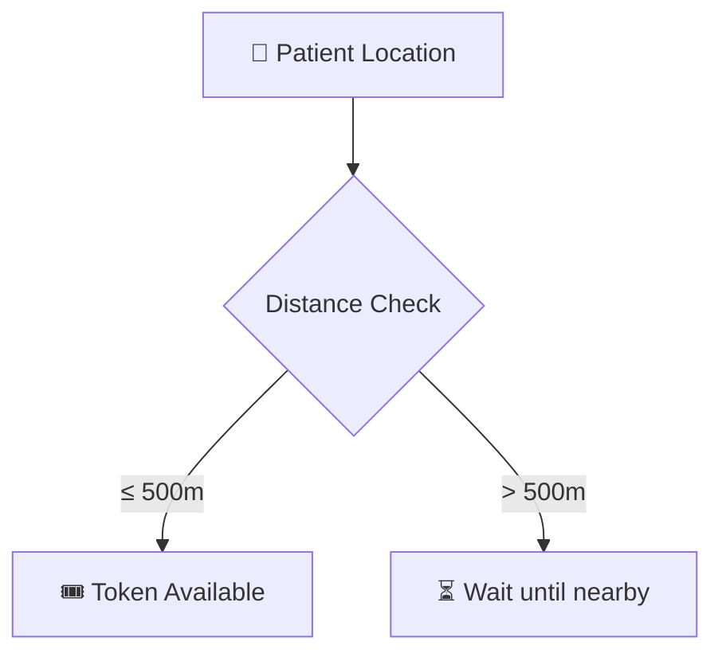

### 🚀 DevOps & Production Engineering

- [ ] Dockerized production environment
- [ ] CI/CD automation
- [ ] Automated testing pipeline
- [ ] Environment-specific deployments
- [ ] Health checks
- [ ] Application monitoring & observability
- [ ] Scalable container orchestration

### 🔮 Future Platform Improvements

- [ ] Real-time queue updates
- [ ] Advanced appointment scheduling
- [ ] Expanded hospital analytics
- [ ] Stronger tenant isolation
- [ ] Improved scalability
- [ ] Mobile experience for patients and hospital staff

---

## 🌐 Explore NOQ

<div align="center">
  
  <a href="https://noq-hospital.vercel.app/signup"></a>
  <a href="https://github.com/sunilt808/Noq-hospital"></a>
  <a href="https://deepwiki.com/sunilt808/Noq-hospital"></a>

  <br/><br/>

  <div style="width: 60%; height: 2px; background: linear-gradient(90deg, #61DAFB, #009688, #47A248); margin: 0 auto;"></div>

  <br/>

  <h3>🏥 NOQ</h3>
  <em><strong>Don't wait in the queue. Know your place in it.</strong></em>  
  <small>Appointments → Tokens → Queues → Consultations → Records → Billing</small>

  <br/>

  <small>Built with ❤️ by **Sunil T**</small>

</div>
