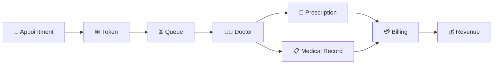
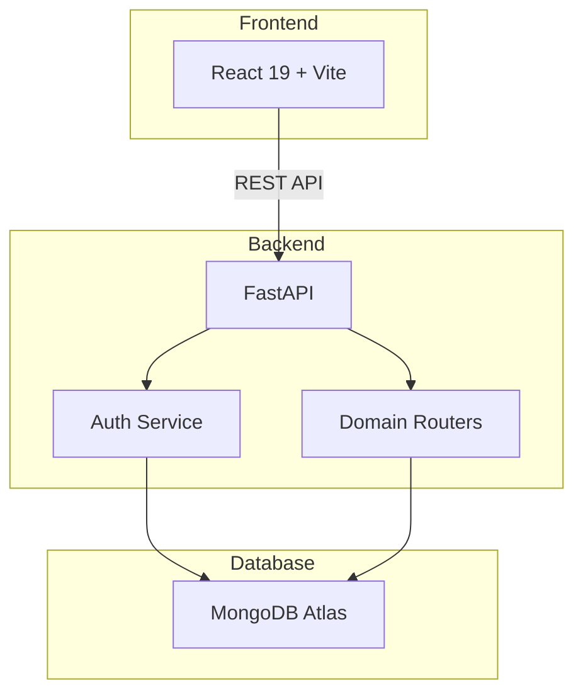

<div align="center">

# 🏥 NOQ

### Smart Queue Management & Hospital Operations Platform

**Appointments → Tokens → Queues → Consultations → Records → Billing**

<br>

<a href="https://noq-hospital.vercel.app/signup">
  
</a>
&nbsp;
<a href="https://github.com/sunilt808/Noq-hospital">
  
</a>
&nbsp;
<a href="https://deepwiki.com/sunilt808/Noq-hospital">
  
</a>

<br><br>

<p>
  <em>
    A full-stack hospital management platform that connects appointments,
    queues,<br>
    consultations, medical records, billing, and revenue operations.
  </em>
</p>

</div>

---

## ✨ Why NOQ?

Hospital visits often involve long waiting times, disconnected workflows, and limited visibility for patients.

**NOQ** brings the complete hospital journey into one digital platform — from booking an appointment and generating a token to consultation, medical records, billing, and revenue management.

### 🎯 What NOQ Solves

* ⏳ Reduces unnecessary patient waiting
* 🎟️ Provides reliable digital token generation
* 📍 Gives patients queue visibility
* 👨‍⚕️ Simplifies doctor workflows
* 📋 Centralizes medical records
* 💳 Streamlines billing and payments
* 📊 Provides hospital revenue analytics
* 🏥 Supports multiple hospitals on one platform

> **Don't wait in the queue. Know your place in it.**

---

## ⚡ Key Features

| Feature                          | Description                                                        |
| :------------------------------- | :----------------------------------------------------------------- |
| 🎟️ **Atomic Token Generation**  | Race-condition-safe token generation for reliable queue management |
| 🏥 **Multi-Tenant Architecture** | Multiple hospitals can operate independently on one platform       |
| 🔐 **JWT + RBAC Security**       | Secure authentication and role-based authorization                 |
| 📅 **Appointment Management**    | Complete appointment booking and lifecycle management              |
| ⏳ **Queue Management**           | Track and manage patient queues in real time                       |
| 🚫 **No-Show Escalation**        | Automated warning → fine → blocking workflow                       |
| 👨‍⚕️ **Doctor Consultations**   | Consultation, prescriptions, and clinical records                  |
| 📋 **Medical Records**           | Centralized patient medical history                                |
| 💳 **Billing & Payments**        | Bill generation and payment tracking                               |
| 💰 **Revenue Analytics**         | Revenue tracking and distribution                                  |
| 🔔 **Notifications**             | Alerts for appointments, queues, and billing                       |
| ⭐ **Reviews & Feedback**         | Patient ratings and feedback                                       |
| 📝 **Complaint Management**      | Structured complaint handling                                      |

---

## 🧠 How It Works



### 🔄 Patient Journey

```text
┌─────────────────────┐
│  Book Appointment   │
└──────────┬──────────┘
           ↓
┌─────────────────────┐
│    Generate Token   │
└──────────┬──────────┘
           ↓
┌─────────────────────┐
│    Join Queue       │
└──────────┬──────────┘
           ↓
┌─────────────────────┐
│ Track Queue Position│
└──────────┬──────────┘
           ↓
┌─────────────────────┐
│ Doctor Consultation │
└──────────┬──────────┘
           ↓
┌─────────────────────┐
│ Prescription +      │
│ Medical Record      │
└──────────┬──────────┘
           ↓
┌─────────────────────┐
│   Billing & Payment │
└──────────┬──────────┘
           ↓
┌─────────────────────┐
│ Revenue & Analytics │
└─────────────────────┘
```

---

## 👥 Four Portals

NOQ provides dedicated experiences for every major role in the hospital ecosystem.

| Portal           | Who Uses It              | Key Actions                                                               |
| :--------------- | :----------------------- | :------------------------------------------------------------------------ |
| 👤 **Patient**   | Patients & visitors      | Book appointments, generate tokens, track queues, view records, pay bills |
| 👨‍⚕️ **Doctor** | Physicians & specialists | Manage queues, consult patients, prescribe, maintain records              |
| 🏥 **Manager**   | Hospital administrators  | Manage departments, doctors, staff, revenue, analytics                    |
| 🛡️ **Admin**    | Platform operators       | Approve hospitals, monitor platform revenue, audit activities             |

---

## 🏗️ Architecture



### Architecture Overview

```text
                 ┌─────────────────────────┐
                 │     React 19 + Vite     │
                 │        Frontend         │
                 └────────────┬────────────┘
                              │
                           REST API
                              │
                 ┌────────────▼────────────┐
                 │         FastAPI         │
                 │         Backend         │
                 └────────────┬────────────┘
                              │
              ┌───────────────┴───────────────┐
              │                               │
     ┌────────▼────────┐             ┌────────▼────────┐
     │   Auth Service  │             │  Domain Routers │
     │    JWT + RBAC   │             │                 │
     └────────┬────────┘             └────────┬────────┘
              │                               │
              └───────────────┬───────────────┘
                              │
                    ┌─────────▼─────────┐
                    │   MongoDB Atlas   │
                    │      Database     │
                    └───────────────────┘
```

---

## 🛠️ Tech Stack

### Frontend

| Technology        | Purpose                           |
| :---------------- | :-------------------------------- |
| ⚛️ **React 19**   | User interface                    |
| ⚡ **Vite**        | Build tool and development server |
| 🟨 **JavaScript** | Application logic                 |

### Backend

| Technology          | Purpose                  |
| :------------------ | :----------------------- |
| 🐍 **Python 3.11+** | Backend language         |
| 🚀 **FastAPI**      | REST API framework       |
| 🎫 **JWT**          | Authentication           |
| 🛡️ **RBAC**        | Role-based authorization |

### Database & Deployment

| Technology           | Purpose                |
| :------------------- | :--------------------- |
| 🍃 **MongoDB Atlas** | Primary database       |
| ▲ **Vercel**         | Hosting and deployment |

---

## 🧩 API Domains

The backend is organized into domain-specific API modules.

| Domain            | Responsibility                        |
| :---------------- | :------------------------------------ |
| `auth`            | Signup, login, JWT issuing            |
| `users`           | User profiles and management          |
| `hospitals`       | Hospital management and approval      |
| `departments`     | Department management                 |
| `doctors`         | Doctor management and assignments     |
| `patients`        | Patient management                    |
| `appointments`    | Appointment lifecycle                 |
| `queues`          | Queue operations and state management |
| `tokens`          | Token generation and tracking         |
| `bills`           | Billing and payments                  |
| `revenue`         | Revenue analytics and distribution    |
| `notifications`   | Alert and notification workflows      |
| `prescriptions`   | Prescription management               |
| `medical_records` | Clinical records and history          |
| `reviews`         | Ratings and feedback                  |
| `complaints`      | Complaint handling                    |

---

## 🎟️ Queue Management

Queue management is one of the core features of NOQ.

The system uses **atomic token generation** to help prevent duplicate token assignment when multiple patients request tokens concurrently.

### Queue Lifecycle

```text
WAITING
   │
   ▼
CALLED
   │
   ▼
IN CONSULTATION
   │
   ▼
COMPLETED
```

### No-Show Escalation

```text
Patient Misses Token
        │
        ▼
     Warning
        │
        ▼
       Fine
        │
        ▼
      Block
```

---

## 🔐 Security

NOQ implements security across authentication, authorization, APIs, and frontend routes.

### Authentication

* 🔑 PBKDF2 password hashing
* SHA-256
* 100,000 iterations
* 🎫 JWT authentication
* ⏱️ Configurable token expiration

### Authorization

* 🛡️ Role-Based Access Control
* 🔒 Protected API endpoints
* 🚧 Protected frontend routes
* 👤 Patient permissions
* 👨‍⚕️ Doctor permissions
* 🏥 Manager permissions
* 🛡️ Admin permissions

> **Security Note:** Never commit `.env` files, database credentials, JWT secrets, or other sensitive configuration to the repository.

---

## 💳 Billing & Revenue

NOQ connects clinical workflows with financial operations.

```text
Doctor Consultation
        ↓
Prescription / Services
        ↓
Bill Generation
        ↓
Payment
        ↓
Revenue Distribution
        ↓
Analytics
```

Hospital managers can monitor revenue activity while platform administrators can manage platform-level revenue and operations.

---

## 🚀 Quick Start

### Prerequisites

Make sure you have:

* Python **3.11+**
* Node.js **18+**
* npm
* MongoDB / MongoDB Atlas
* Git

---

### 1. Clone the Repository

```bash
git clone https://github.com/sunilt808/Noq-hospital.git
cd Noq-hospital
```

---

### 2. Backend Setup

```bash
cd backend
```

Create a virtual environment:

```bash
python -m venv venv
```

Activate it.

**Linux / macOS**

```bash
source venv/bin/activate
```

**Windows**

```bash
venv\Scripts\activate
```

Install dependencies:

```bash
pip install -r requirements.txt
```

---

### 3. Configure Backend

Create:

```text
backend/.env
```

Add:

```env
MONGODB_URL=mongodb://your-mongodb-url
DATABASE_NAME=noq_hospital_db

JWT_SECRET=your-secret
JWT_EXPIRATION_MINUTES=1440

FRONTEND_URL=http://localhost:5173
```

Initialize MongoDB:

```bash
python init_mongo.py
```

Start the backend:

```bash
uvicorn main:app --host 127.0.0.1 --port 8000 --reload
```

Backend:

```text
http://127.0.0.1:8000
```

---

### 4. Frontend Setup

Open another terminal:

```bash
cd noq-frontend
```

Install dependencies:

```bash
npm install
```

Create:

```text
noq-frontend/.env
```

Add:

```env
VITE_API_URL=http://127.0.0.1:8000
```

Start the frontend:

```bash
npm run dev
```

Frontend:

```text
http://localhost:5173
```

---

## 📂 Project Structure

```text
Noq-hospital/
│
├── backend/
│   ├── routers/
│   │   ├── auth/
│   │   ├── users/
│   │   ├── hospitals/
│   │   ├── departments/
│   │   ├── doctors/
│   │   ├── patients/
│   │   ├── appointments/
│   │   ├── queues/
│   │   ├── tokens/
│   │   ├── bills/
│   │   ├── revenue/
│   │   ├── notifications/
│   │   ├── prescriptions/
│   │   ├── medical_records/
│   │   ├── reviews/
│   │   └── complaints/
│   │
│   ├── main.py
│   ├── init_mongo.py
│   ├── requirements.txt
│   └── .env
│
├── noq-frontend/
│   ├── src/
│   ├── public/
│   ├── package.json
│   └── .env
│
└── README.md
```

> The project structure may evolve as new modules and features are added.

---

## 🗺️ Roadmap

| Priority   | Feature                                                         |   Status   |
| :--------- | :-------------------------------------------------------------- | :--------: |
| 🔴 High    | Priority advance booking — seniors, pregnant patients, children | 🟡 Planned |
| 🟠 Medium  | 500m location-based token generation                            | 🟡 Planned |
| 🟡 Low     | Dockerized deployment                                           | 🟡 Planned |
| 🟢 Backlog | CI/CD pipeline                                                  |  ⚪ Backlog |
| 🟢 Backlog | Automated testing                                               |  ⚪ Backlog |

---

## 🤝 Contributing

Contributions are welcome.

### Workflow

1. Fork the repository
2. Create a feature branch

```bash
git checkout -b feature/your-feature
```

3. Make your changes
4. Commit your changes

```bash
git commit -m "feat: add your feature"
```

5. Push your branch

```bash
git push origin feature/your-feature
```

6. Open a Pull Request

---

## 🔒 Environment Variables

### Backend

```env
MONGODB_URL=
DATABASE_NAME=
JWT_SECRET=
JWT_EXPIRATION_MINUTES=
FRONTEND_URL=
```

### Frontend

```env
VITE_API_URL=
```

Add these to `.gitignore`:

```gitignore
.env
.env.local
.env.*.local

venv/
__pycache__/
node_modules/
```

---

## 🔗 Project Links

<div align="center">

<a href="https://noq-hospital.vercel.app/signup">
  
</a>

<a href="https://github.com/sunilt808/Noq-hospital">
  
</a>

<a href="https://deepwiki.com/sunilt808/Noq-hospital">
  
</a>

</div>

---

## 👨‍💻 Author

<div align="center">

### Sunil T

Built with ❤️ to make hospital queues smarter, faster, and more transparent.

<br>

**🏥 NOQ — Don't wait in the queue. Know your place in it.**

</div>

---

<div align="center">

⭐ **If you find NOQ useful, consider giving the repository a star!**

</div>
